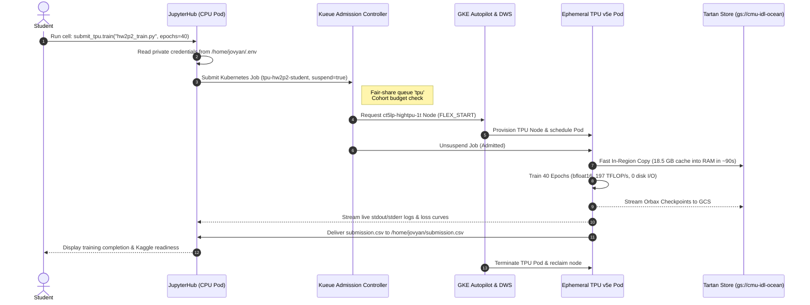

# 🏛️ Architecture: CMU 11-785 Tartan Computing & TPU Sharing

This document details the architectural design of the **CMU 11-785 Cloud TPU Hub** as of the October 2026 GKE Autopilot standards.

---

## 1. The Core Challenge & Philosophy

In conventional cloud educational environments, attaching an accelerator (GPU or TPU) directly to an interactive Jupyter notebook creates severe cost and utilization penalties:
- A Cloud TPU v5e (`ct5lp-hightpu-1t`) costs **$1.35/hour** ($0.375/chip-hr on preemptible/spot).
- If 300 students keep an interactive notebook tab open for 8 hours/day to read assignments and debug code, an attached hardware setup would cost **$405/hour ($3,240/day)**, quickly depleting course budgets.
- Interactive accelerator sessions typically sit idle >85% of the time during active thinking, reading, and plotting.

### Our Solution: Decoupled Ephemeral Batch Execution
Our architecture completely decouples the student editing environment from the accelerator hardware:
1. **Low-Cost Spot CPU Notebooks**: Students work in lightweight, persistent CPU containers (2 vCPU, 16 GiB RAM, 32 GiB NVMe home disk) backed by Spot VMs (~$0.06/hour).
2. **Kueue 0.8+ Batch Admission**: When a student runs heavy training via `submit_tpu.train()`, code is submitted as an ephemeral Kubernetes `Job` to a fair-share queue.
3. **Dynamic Workload Scheduler (DWS) Flex Scaling**: GKE Autopilot provisions TPU nodes from the Flex Pool on-demand, executes training, streams logs live, saves durable Orbax checkpoints, deposits `submission.csv` back to the student's persistent volume, and terminates the node immediately upon completion.
4. **Zero-Rebuild Tartan Shared Storage**: Central course packages, datasets, and project directories live in a high-speed GCS FUSE mount (`/tartan/11785/`), eliminating Docker container rebuilds.

---

## 2. Tartan 3-Tier Storage Hierarchy

Inspired by supercomputing file hierarchies (e.g., PSC Bridges-2/3 `$PROJECT` / `$OCEAN` / `$SCRATCH`) and adapted for cloud-native Kubernetes:

```
┌────────────────────────────────────────────────────────────────────────┐
│               CMU 11-785 Tartan 3-Tier Storage Architecture            │
└────────────────────────────────────────────────────────────────────────┘

  Tier 1: Private Persistent Workspace ($HOME)
  ├── Path: /home/jovyan/
  ├── Medium: Regional SSD PersistentDisk (standard-rwo-retain)
  ├── Scope: Private per-student, retained for entire term
  ├── Quota: 32 GiB (Tier 0 Coursework) -> 100 GiB (Tier 1 Capstone)
  └── Contents: Source code, .env credentials, personal checkpoints, submission.csv

  Tier 2: Central Shared Course Store (/tartan/11785/ & /ocean/)
  ├── Path: /tartan/11785/ (dual-mounted to /ocean for backward compatibility)
  ├── Medium: Google Cloud Storage (gs://cmu-idl-ocean) via GCS FUSE CSI
  ├── Caching: Local NVMe file cache (50 GB), metadata stat cache (2048 MB)
  ├── Throughput: Line-rate (>1.2 GB/s) with 0 network egress charge in us-west4
  ├── Permissions: Read-only for students, Read-write for staff/maintainers
  └── Contents:
      ├── /tartan/11785/datasets/      (Shared benchmark datasets & .npy caches)
      ├── /tartan/11785/assignments/   (Official handout notebooks & starter code)
      ├── /tartan/11785/projects/      (Shared capstone & research team directories)
      └── /tartan/11785/envs/          (Shared live Python env: idl-shared-env)

  Tier 3: Ephemeral Node Scratch ($TMPDIR)
  ├── Path: /tmp/
  ├── Medium: High-speed local NVMe attached to GKE node
  ├── Lifetime: Destroyed when container/job exits
  └── Contents: Fast memory-mapped caches, unpack scratch, temporary buffers
```

### Dual Mount & Zero-Rebuild Shared Environments
- To provide 100% backward compatibility for legacy coursework scripts referencing `/ocean`, the central GCS bucket `gs://cmu-idl-ocean` is mounted at **both** `/tartan/11785` and `/ocean`.
- Course packages reside in `/tartan/11785/envs/idl-shared-env` and are auto-discovered by Jupyter via:
  ```yaml
  JUPYTER_PATH: "/tartan/11785/share/jupyter:/ocean/share/jupyter:/opt/conda/share/jupyter"
  PYTHONPATH: "/opt/course:/tartan/11785/envs/idl-shared-env/lib/python3.11/site-packages"
  ```
- Teaching assistants install packages once (`conda run -p /tartan/11785/envs/idl-shared-env pip install <pkg>`); all 300 students receive them in seconds without modifying the Docker image.

---

## 3. End-to-End System Execution Flow

The following sequence illustrates a student training on Cloud TPU v5e via `submit_tpu.train()`:



---

## 4. Software-Defined Student Project Grants

To support capstone projects and faculty-sponsored research without creating administrative overhead, the platform implements a 4-tier software-defined resource model:

| Grant Level | Target Audience | PVC Storage | CPU Guarantee / Limit | RAM Limit | Accelerator Access | Spawner Visibility |
| :--- | :--- | :--- | :--- | :--- | :--- | :--- |
| **Tier 0: Coursework** | All 300 students | 32 GiB | 1 / 2 vCPU | 16 GiB | Queued v5e via `submit_tpu` | Default (Unrestricted) |
| **Tier 1: Capstone Team** | Approved Capstone Teams | 100 GiB | 2 / 4 vCPU | 32 GiB | Queued v5e + Priority queue | Group `project-grant-tier1` |
| **Tier 2: Research Fellow**| Faculty Fellows / Comp | 200 GiB | 4 / 8 vCPU | 64 GiB | Queued + Pinned v5e slice | Group `tpu-access` / `staff` |
| **Maintainer Workstation** | Course Staff / Maintainer | 100 GiB | 8 / 16 vCPU | 64 GiB | Unrestricted Pinned v5e | Group `staff` / `admin` |

### Dynamic Profile Filtering & Compute Overrides
1. **Dynamic Spawner Filtering (`filter_profile_list`)**:
   In `k8s/jupyterhub-values.yaml`, a custom Python filter evaluates the authenticated user's group memberships and exposes high-compute and pinned accelerator profiles strictly to authorized students.
2. **Dynamic In-Flight Overrides (`apply_custom_user_resources`)**:
   Staff award grants using `python scripts/hub_admin.py grant <student> --tier 1`. This immediately resizes the student's PVC online via the GKE CSI driver and writes compute limits to the `cmu-user-overrides` ConfigMap, which are automatically applied on the student's next notebook launch.

---

## 5. Security Posture (CIS & NIST Guidelines)

Following **NIST SP 800-190** (Application Container Security Guide) and the **CIS GKE Benchmark v1.5.0**:

- **Zero-Trust Identity-Aware Proxy (IAP)**: All ingress is authenticated via Google SSO at the Google Front End (GFE). The custom `IAPAuthenticator` decodes the signed `x-goog-iap-jwt-assertion` using Google's public ES256 keys, extracting verified Andrew/CMU email identities.
- **Role-Based Access Control (RBAC)**: Student pods run as a restricted `ServiceAccount` (`student`) bound to Role `student-tpu-submit`. Students can create, watch, and read logs of Jobs *only* in `cmu-idl`. They cannot view or touch other students' pods.
- **Container Sandboxing (gVisor)**: Interactive CPU notebook pods execute under **gVisor** (`runtimeClassName: gvisor`), intercepting system calls and isolating untrusted Python code from the host Linux kernel. TPU batch pods execute as non-root users directly on bare-metal accelerator nodes where hardware drivers require host access.
- **Network Egress Isolation**: Dataplane V2 (Cilium) NetworkPolicies allow notebook pods to communicate strictly with the Kubernetes API Server Endpoint (`443`) and approved external domains (Kaggle, WandB, Hugging Face). Access to `169.254.169.254` (cloud metadata) and internal cluster subnets is strictly blocked.
- **Student Credential Privacy**: Personal tokens (WandB, Kaggle) reside exclusively in `/home/jovyan/.env` on the student's private PVC. During training, `submit_tpu.py` passes them securely to the job pod and logs only truncated sha256 digests (`sha256[:8]`). Cleartext secrets are never emitted to logs or visible across students.
