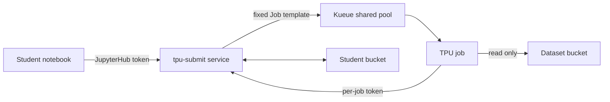
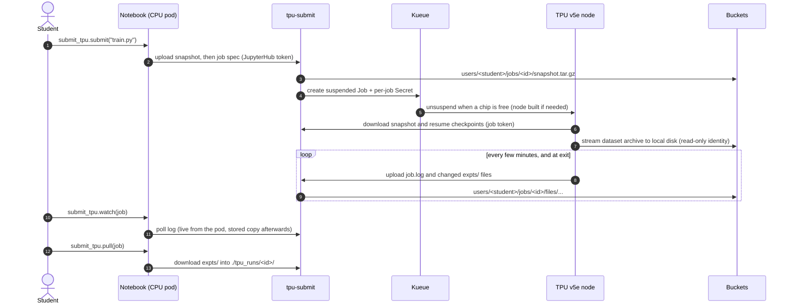
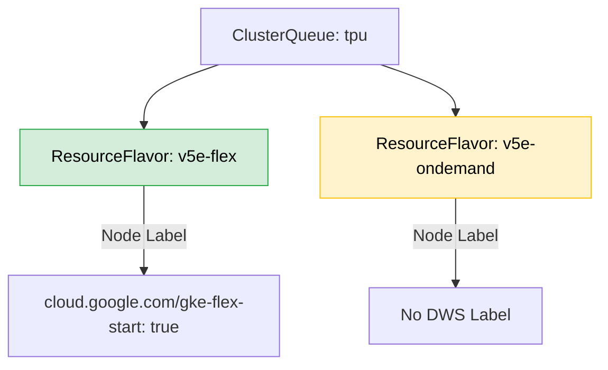

# 🏛️ Architecture: Ephemeral TPU Sharing

This document details the architectural design of the `shared-tpu-notebooks` environment as of the 2026 GKE Autopilot standards.

## The Core Problem

In standard Cloud environments, a Jupyter notebook running on an accelerator node permanently holds that accelerator for as long as the session is active. A Cloud TPU v5e (`ct5lp-hightpu-1t`) costs roughly $1.35/hour. If 300 students keep a tab open to read assignments and occasionally run code, it would cost **$405/hour**, which is prohibitively expensive for a course budget.

## The Solution: Decoupled Job Execution

Instead of providing a TPU to the notebook directly, this architecture decouples the notebook from the hardware.

1. **CPU Notebooks:** Students are given a low-cost Spot CPU notebook (2 vCPU, 16 GiB RAM, 32 GiB home disk). They write and unit-test their code here.
2. **Script Submission:** When a training script is ready, `submit_tpu.submit("train.py", ...)` packs the script's folder and sends it to the **tpu-submit service**, much like `sbatch` on a Slurm cluster.
3. **One Fixed Job Template:** tpu-submit is the only thing allowed to create Kubernetes Jobs. It builds each one from a single template (one chip, the course image, the queue, a deadline) and enforces one active job per student and an optional chip-hour budget.
4. **Queue Execution:** `Kueue` (the admission controller) queues these Jobs against a shared pool of TPU resources (e.g., 32 or 64 chips).
5. **Local Data, Mirrored Results:** On the chip, a wrapper unpacks the student's folder and the assignment dataset onto local disk, runs the script, and uploads `job.log` and the `expts/` folder (checkpoints, `results.csv`) through tpu-submit every few minutes and at exit.
6. **Scale-to-Zero:** GKE Autopilot provisions TPU nodes from the Dynamic Workload Scheduler (DWS) Flex Pool only when jobs exist, and destroys them after.

---

## 🏗️ System Diagram



The sequence for one run:



### Disruptions and resuming

The Job's `podFailurePolicy` ignores pods that fail with a `DisruptionTarget` condition (preemption, node maintenance, Kueue eviction). A new pod starts, downloads that Job's last uploaded `expts/`, and the training script resumes from its last checkpoint. A non-zero exit from the student's own code fails the Job instead of retrying it. To continue a finished, failed, or timed-out run, the student submits again with `resume_from=<old job>`.

### Bucket layout

```
gs://STUDENT_BUCKET/users/<student>/jobs/<job id>/
    meta.json          state and timestamps, written only by tpu-submit
    snapshot.tar.gz    the folder as submitted
    files/job.log      console output
    files/expts/...    checkpoints, results.csv, anything the script writes to expts/
```

Chip-hour usage is computed from the start and end times in `meta.json`, so it survives the Job object being deleted an hour after it finishes.

## Security Posture (CIS & NIST Guidelines)

Following **NIST SP 800-190** (Application Container Security Guide) and the **CIS GKE Benchmark v1.5.0** (2026):

- **No Kubernetes access for students:** Notebooks run with no service-account token (`automount_service_account_token: false`) and students have no RBAC. An earlier design let every notebook create, list, and delete Jobs and read every pod's logs in the shared namespace, which meant any student could read or kill anyone's work and choose arbitrary node selectors. That access is gone; `03_deploy_hub.sh` deletes the old `student` service account and Role.
- **One gate for TPU work:** tpu-submit checks the caller's JupyterHub token by asking the hub who owns it. Notebook tokens carry an `access:services!service=tpu-submit` scope for exactly this. Every request is scoped to that student's own jobs and their `users/<student>/` folder. The student chooses only the script path, its arguments, the dataset name (from a host-defined list), and environment variables; the image, chip count, node selector, priority, deadline, and service account are fixed.
- **Per-job tokens:** Each Job gets a random token in a Secret owned by the Job. The service stores only its SHA-256 hash, in a Job annotation. The token can download only that job's snapshot and inputs, and upload only into that job's folder. The wrapper removes it from the environment before the student's script starts.
- **Secrets passed with `env=`:** Values such as a W&B key go into the same Job-owned Secret and are deleted with the Job. They are never written to the bucket, the snapshot, or `meta.json`. `submit()` also never packs notebooks, `kaggle.json`, `.env`, `.netrc`, or key files.
- **Storage identity via Workload Identity:** No Google service accounts or keys. The student bucket grants `objectAdmin` to the `tpu-submit` Kubernetes service account only; the dataset bucket grants `objectViewer` to `tpu-job` only (`scripts/12_setup_storage.sh`). Student code on the chip therefore can read the course data and nothing else in Cloud Storage.
- **Identity-Aware Proxy (IAP):** Replaces basic auth. All traffic is zero-trust, authenticated by Google SSO via the GFE (Google Front End).
- **Network Isolation:** Notebook egress to private addresses is denied except to the tpu-submit pods on port 8080. tpu-submit accepts connections only from notebooks and TPU job pods. Egress to `169.254.169.254` (metadata) is blocked for notebooks.
- **Container Sandboxing:** Notebook pods utilize **gVisor** (`runtimeClassName: gvisor`) to strictly isolate untrusted python code from the GKE host kernel. TPU jobs bypass this solely because hardware drivers require host kernel access; they run as non-root with all capabilities dropped and no Kubernetes token.

## Queuing Architecture (Multi-Flavor)



Kueue is configured to attempt `FLEX_START` (highly available but zone-specific) first. If the flex pool is exhausted or unsupported in the zone, it falls back to standard on-demand capacity, ensuring seamless class execution.
