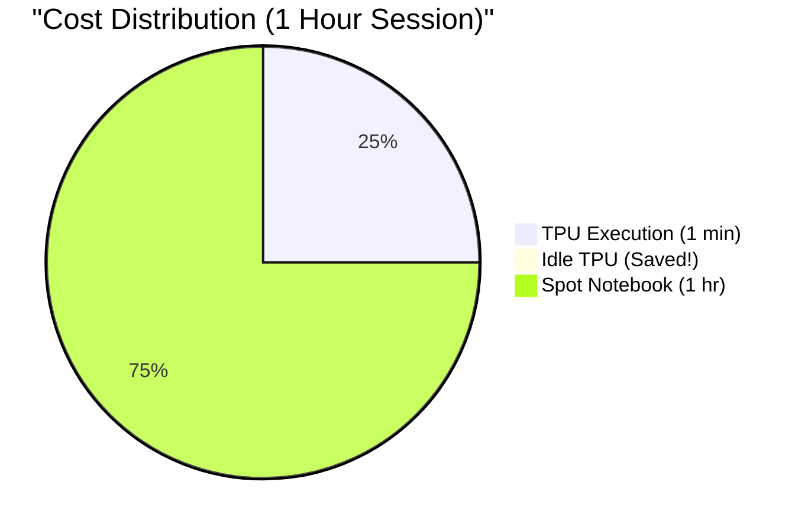

# 💰 Cost Management & Budgeting

Running TPUs for hundreds of students can drain a budget rapidly if mismanaged. This repository is architected to keep costs below **$0.10 per student per session**.

## Where the Money Goes

In a GKE Autopilot cluster, you pay for what pods *request*, not what the underlying VM nodes have.

1. **The Notebook Pod (CPU):** A 2 vCPU, 16 GiB RAM pod with a 32 GiB home disk.
2. **The TPU Job:** A `ct5lp-hightpu-1t` node carrying 1x v5e chip.
3. **Cluster Management Fee:** $0.10/hour per cluster.

### Spot vs. On-Demand Pricing

We aggressively use Spot VMs for the Jupyter notebooks.

| Resource | On-Demand (Hourly) | Spot (Hourly) | Savings |
| :--- | :--- | :--- | :--- |
| **Notebook (2 vCPU, 16 GiB)** | ~$0.16 | **~$0.06** | ~63% |
| **TPU v5e Chip** | $1.20 | $0.36 | ~70% |

*Note: The TPU pool defaults to On-Demand via DWS Flex because Spot TPUs can be preempted mid-execution, frustrating students. Notebooks, however, can handle preemption transparently since data is backed by Persistent Volumes.*

## Automated Cost-Saving Mechanisms

### 1. Idle Culler

Students frequently forget to close browser tabs. The `jupyterhub-values.yaml` is configured with an aggressive culler:

```yaml
cull:
  enabled: true
  timeout: 3600    # Cull if idle for 60 minutes
  every: 300       # Check every 5 minutes
  maxAge: 28800    # Hard kill after 8 hours, even if active
```

### 2. Ephemeral TPU Execution

Because TPU work is sent as a queued job with `submit_tpu.submit()`, a chip bills only while a student's script runs, not while their notebook is open.


*(Y-axis is in cents)*

### 3. Training Runs: Job Length and Chip-Hour Budget

From HW3 on, a job is a full training run, not a 15-second snippet, and that changes the arithmetic. A job bills about **$1.35 per chip-hour for its whole run**, including the minutes it spends downloading the dataset to local disk.

| Pool | Job length | One run per student (300) | Wall time to drain | TPU cost |
| :--- | :---: | :---: | :---: | :---: |
| 64 chips | 8 h | 5 back-to-back rounds | ~40 h | ~$3,200 |
| 64 chips | 4 h | 5 rounds | ~20 h | ~$1,600 |
| 128 chips | 8 h | 3 rounds | ~24 h | ~$3,200 |

The cost per pass does not depend on the pool size; the pool only decides how long the queue takes to drain. The two levers are in `config.env` and are enforced by the tpu-submit service:

- **`MAX_JOB_HOURS`** becomes each Job's `activeDeadlineSeconds`. Time spent waiting in the Kueue queue does not count. When it runs out, the script gets SIGTERM, the wrapper uploads the last checkpoint, and the student can continue with `resume_from=`.
- **`CHIP_HOUR_BUDGET`** is a per-student total, computed from the start and end times tpu-submit records in the bucket. Once a student reaches it, new submissions are refused with a message to ask a TA. `0` disables it.
- **One active job per student** (queued or running) is always enforced, so nobody can hold several chips or several places in line.

Set both after one measured baseline run of the assignment on v5e. That run gives the epoch time and the dataset size; the dataset size also decides `JOB_DISK`, which has to fit Autopilot's ephemeral-storage limit for TPU pods.

To see who is using what, list every live job as an admin (with a JupyterHub API token):

```bash
kubectl -n cmu-idl port-forward svc/tpu-submit 18080:8080 &
curl -s -H "Authorization: token $HUB_TOKEN" "http://127.0.0.1:18080/api/jobs?all=1"
curl -s -H "Authorization: token $HUB_TOKEN" "http://127.0.0.1:18080/api/me?user=<student>"
```

### 4. Storage for Job Files

Job snapshots, logs, and checkpoints live in `STUDENT_BUCKET`. `make storage` turns off soft delete on that bucket, because jobs overwrite their checkpoint every epoch and each overwritten copy would otherwise bill for seven more days, and expires objects after `RUNS_RETENTION_DAYS`. TPU job console output is excluded from Cloud Logging (`student-tpu-job-noise`), since the bucket already keeps it as `job.log`.

### 5. The Warm Pool Guardrail

Instructors can hold a "warm" TPU node via `make warm-on WARM=1` to prevent cold-starts during a live lecture. Because a warm node bills $1.35/hour constantly, we have a failsafe:

The `tpu-warm-pool.yaml` manifest includes a `CronJob` that executes `kubectl scale deployment tpu-warm-pool --replicas=0` every day at **22:00 UTC**. If you forget to run `make warm-off`, the cluster shuts it off for you.

## End of Term Cleanup

Persistent Volumes (student home directories) bill perpetually until deleted. To stop all billing at the end of the term:

```bash
# Preview what will be deleted
make clean-pvcs-dry-run

# Execute the deletion
make clean-pvcs

# Destroy the cluster completely
make teardown
```
