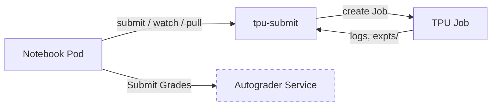

# 🛠️ Developer Guide

This guide is for teaching assistants, instructors, or system administrators who need to modify the codebase, adjust logic, or upgrade components.

## Directory Structure & Responsibilities

- **`docker/`**: The CPU notebook image. **`docker/tpu-job/`** is the image student scripts run in on the chip, plus `tpu_entrypoint.py`, the wrapper that fetches files, runs the script, and uploads results.
- **`services/tpu-submit/`**: The submission service. `core.py` holds every rule (validation, one active job, budget, ownership); `jobspec.py` is the one Job template; `app.py` is the HTTP layer.
- **`k8s/`**: Kubernetes YAML manifests. Changes to security, quotas, and hub configuration happen here. `tpu-submit.yaml` deploys the service.
- **`notebooks/`**: The Python client (`submit_tpu.py`) that students use to queue jobs.
- **`tests/`**: `make test` runs unit tests and an end-to-end test (client → service → wrapper → service → client) with a fake cluster and a local directory standing in for the bucket. No cloud access needed.
- **`scripts/`**: Bash utilities and python benchmarking scripts. **All scripts use `common.sh` for standardized logging and error handling.**

## Modifying the Bash Scripts

We strictly enforce 2026 bash standards. When writing or editing scripts in `scripts/`:

1. **Always source `common.sh`**:
   ```bash
   source "$(dirname "${BASH_SOURCE[0]}")/common.sh"
   ```
2. **Use strict mode**: `set -euo pipefail` is mandatory.
3. **Use log functions**: Do not use `echo`. Use `log_info`, `log_success`, `log_warn`, and `log_error`.
4. **Use Docstrings**: Every bash script must start with a descriptive header block explaining its inputs, outputs, and side effects.

## Modifying the Client and the Service

The client (`notebooks/submit_tpu.py`) only talks HTTP to tpu-submit; it cannot change the Job. Anything about how a job runs (image, chip count, deadline, env) is decided in `services/tpu-submit/tpu_submit/jobspec.py` and `config.py`, and set per deployment through `config.env` → `03_deploy_hub.sh` → `k8s/tpu-submit.yaml`.

1. A new student-facing option needs a field in `Core.validate_request`, a parameter in `submit()`, and a test in `tests/test_core.py`. Treat every field as hostile input.
2. **Never** let a request field reach the Job spec unchecked, and never request privileges (`run_as_root`, `privileged: true`). GKE Autopilot's mutating admission webhook will reject them anyway.
3. After changing the service, run `make test`, then `make image` (or `bash scripts/01_build_image.sh tpu-submit`) and `make hub`.
4. After changing the TPU job image or wrapper, `bash scripts/01_build_image.sh tpu-job`. The next job uses it.

## Upgrading the JupyterHub Helm Chart

To bump the JupyterHub version:
1. Modify `scripts/03_deploy_hub.sh`.
2. Update the `--version` flag in the `helm upgrade` command.
3. Review the Zero-to-JupyterHub changelog, particularly around `singleuser.networkPolicy` and `Authenticator` configurations, as these frequently contain breaking changes.

## Adding New Subsystems

### System Diagram Context

When adding new components (e.g., a grading service), consider how it interacts with the existing flow:



Ensure the grading service runs in the `cmu-idl` namespace and its `NetworkPolicy` allows ingress from the pods that need it. Notebooks deny egress to private addresses by default, so a new in-cluster service also needs a rule under `singleuser.networkPolicy.egress` in `jupyterhub-values.yaml`, like the one for tpu-submit.
